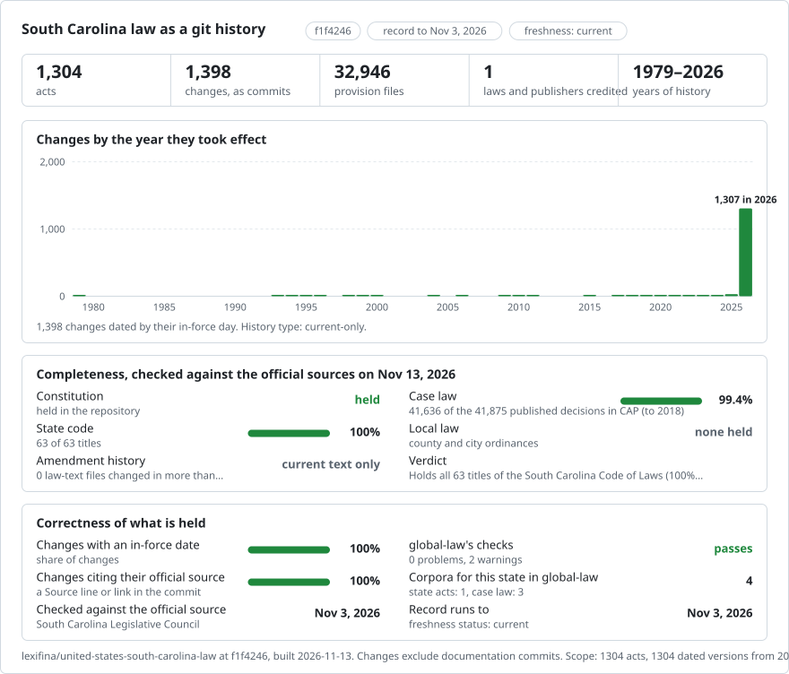

# South Carolina: law history in git

<picture>
<source media="(prefers-color-scheme: dark)" srcset="data/effort-dark.svg">

</picture>

Part of [lexifina/global-law](https://github.com/lexifina/global-law), one git history for every country's law: this is the law of South Carolina, United States, which global-law reads at `united-states/south-carolina/acts/`.

The statute law of South Carolina as a git repository: one file per section, committed with the South Carolina Legislative Council as its publisher. It follows the shared design of [lexifina/global-law](https://github.com/lexifina/global-law).

**What is in it now**

| Folder | Act | Versions | History |
| --- | --- | ---: | --- |
| `constitution/` | Constitution of the State of South Carolina (1895, as amended; unannotated) | 1 | Oldest version available |
| `title-16-ch-01/` ... | Code of Laws Title 16, Crimes and Offenses (every chapter) | 1 each | Oldest version available |
| `title-33-ch-01/` ... | Title 33 chapters 1 to 20 (corporations) | 1 each | Oldest version available |
| `title-27-ch-01/` ... | Title 27 chapters 1 to 8 (property and conveyances) | 1 each | Oldest version available |
| `title-1-ch-01/` ... `title-63-ch-..` | Every other chapter of Titles 1 to 63 (1,260 chapters, added 3 November 2026) | 1 each | Oldest version available |
| `regulation-ch-001/` ... `regulation-ch-139/` | South Carolina Code of Regulations, 94 of 107 listed chapters | 1 each | Oldest version available |

This repository holds the Constitution, every Code of Laws chapter that has sections, and 94 Code of Regulations chapters. Regulation chapters 30, 69 and 79 are held because their official PDFs contain pages without a text layer. Chapters 3, 23, 45, 50, 83, 104, 112, 125, 132 and 133 are held because their PDFs give no chapter-specific effective or amendment date. Session Acts and earlier editions remain outside this record.

## Where the text comes from

The Legislative Council's unannotated Code chapter pages, Constitution PDF, and Code of Regulations chapter PDFs. Each statute section keeps its text and its HISTORY line (the acts that made it). Editor's notes, Code Commissioner's notes and notes on the effect of amendments are left out. Where the Code prints one section number twice (a text in force until a contingency and the text that would replace it, or a later-effective text), both texts are kept; the second is the file ending -v2. Each regulation chapter keeps its complete PDF text layer in one file. Some chapter PDFs contain illustrations or forms published as images; those images await the corpus asset support.

## Dates

The Council states no in-force date for the Code, only that it is current through the 2026 Session, so each chapter is one version dated the day before it was retrieved (29 October 2026 for Titles 16, 27 and 33, 2 November 2026 for the rest) (a commit cannot be dated later than the build). That is a retrieval date, not the day the words took effect. The Constitution is dated 23 October 2026, the date of the Council's "updated through the 2026 Session" notice. Each regulation chapter is dated by its own latest dated HISTORY amendment or explicit commencement, including later legal changes stated elsewhere in its PDF. Chapter 139 uses 3 May 2018, when Act No. 163 repealed regulations for recognizing additional Native American Indian groups; chapter 137 uses 1 January 2026, when its stated appraisal education requirements commence. The regulations listing's State Register Volume 50, Issue 3, effective 27 March 2026, is the collection currency date only. The Council keeps yearly archived Code editions from 2000 that say only "updated through the end of the year Session"; they are the next step, with the HISTORY lines naming the acts.
